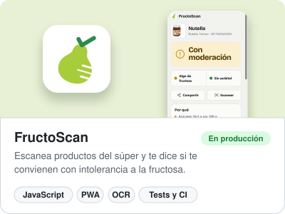
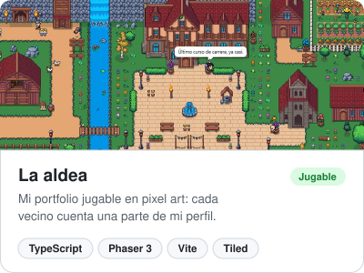
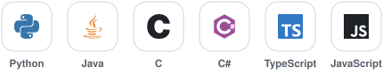
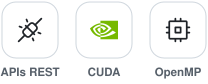
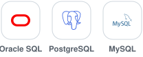
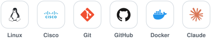

<h1 align="center">Hola, soy Alejandro Revilla 👋</h1>

## 🧑‍💻 Sobre mí

- 🎓 Estudiante de 4º de **Ingeniería Informática** en la UCAM (Murcia).
- 🤖 Me estoy especializando en **IA aplicada**: agentes con modelos de lenguaje, datos y machine learning.
- 🗄️ Base sólida en **bases de datos**: SQL, PL/SQL y modelado con Oracle (Oracle Database Academy).
- 🌐 Sistemas y redes: ruta **Cisco CCNA** (3 módulos) y **NDG Linux Essentials**.
- 📚 Ahora mismo: **Ciberseguridad y Hacking Ético** (BIG School), **CS50x** (Harvard) y **Python Essentials** (Cisco), preparando el examen PCAP.
- 📫 **Busco prácticas desde enero de 2027** en IA, datos o backend, en Murcia o en remoto.

## 📌 Proyectos

  <a href="https://github.com/alejandrorevillaEng/fructoscan"><picture><source media="(prefers-color-scheme: dark)" srcset="assets/proyecto-fructoscan-oscuro.svg"></picture></a>
  <a href="https://github.com/alejandrorevillaEng/portafolio-alejandro-prueba1"><picture><source media="(prefers-color-scheme: dark)" srcset="assets/proyecto-aldea-oscuro.svg"></picture></a>

**FructoScan** · [código](https://github.com/alejandrorevillaEng/fructoscan) · [abrir la app](https://fructosa.pages.dev) &nbsp;&nbsp;·&nbsp;&nbsp; **La aldea** · [código](https://github.com/alejandrorevillaEng/portafolio-alejandro-prueba1) · [jugar](https://alejandrorevillaeng.github.io/portafolio-alejandro-prueba1/)

## 🛠️ Tecnologías

**Lenguajes**

<picture>
  <source media="(prefers-color-scheme: dark)" srcset="assets/lenguajes-oscuro.svg">
  
</picture>

**Backend y programación paralela**

<picture>
  <source media="(prefers-color-scheme: dark)" srcset="assets/backend-oscuro.svg">
  
</picture>

**Bases de datos**

<picture>
  <source media="(prefers-color-scheme: dark)" srcset="assets/datos-oscuro.svg">
  
</picture>

**Sistemas, redes y herramientas**

<picture>
  <source media="(prefers-color-scheme: dark)" srcset="assets/sistemas-oscuro.svg">
  
</picture>

<em>Construyendo mi camino hacia la IA aplicada 🚀</em>

